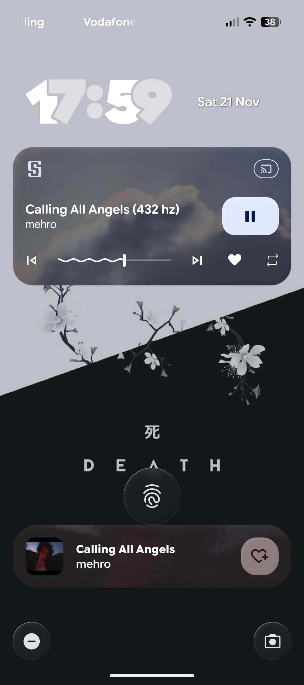
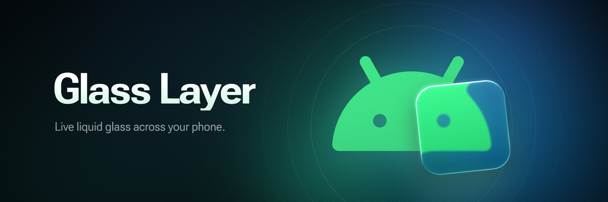

# GlassLayers

Live liquid glass for your phone's System UI, an Xposed (LSPosed / Vector) module.

> **Fork notice:** GlassLayers is a fork of [GlassLayer](https://github.com/Mahmud0808/GlassLayer) by
> [Mahmud0808 (DrDisagree)](https://github.com/Mahmud0808), licensed under the GPLv3. All credit for the original
> project goes to him. See [NOTICE.md](NOTICE.md).
>
> This fork adds: glass Now Playing card (incl. like / play buttons), glass lockscreen fingerprint, and a fix for the
> restart banner getting stuck after updates.
>
> Heads up: this app has its own package id (`com.evergreenpro.glasslayers`), so it installs next to the original. Enable only one of
> them in LSPosed or SystemUI gets hooked twice.
## Preview

  

## README

  

# Glass Layer

Brings iOS-style liquid glass to Android. Glass Layer is a root module that turns system UI into live glass: real-time refraction, blur, rim light and reflection over whatever is behind each surface.

## Surfaces

- **Quick settings**: background, tiles, footer buttons, brightness slider, media player
- **Notifications**: notifications, heads-up, status bar chips, toasts
- **Lockscreen**: notifications, Now Playing card, fingerprint, shortcuts, PIN pad
- **Volume**: volume dialog, expanded volume panel
- **Dialogs and menus**: system dialogs, power menu, expand animations
- **Controls**: buttons, switches, sliders (also in Settings and the package installer)
- **System apps**: Settings cards, installer dialogs

Every surface has its own switch, tint and glass style (blur, refraction, reflection, rim, shadow). Changes apply live, no SystemUI restart needed.

## Before you install

Glass Layer is made for my personal use and shared as is, with no warranty.

- **Tested on:** PixelOS, Android 17 (October update). It is fully tested and working there. Other ROMs and versions may work, partly work or not work at all.
- **Device:** live glass works best on a powerful device (recent mid-range or flagship chip). On older phones, lower the glass frame rate in the app under Performance for smoother results.
- **Issues:** I won't fix issues that don't affect my daily usage. Other reports will likely stay open.
- **Need a fix?** Fork the repo and fix it yourself. Pull requests are welcome, but there is no promise they get merged.

## Requirements

- Android 16 or newer
- A powerful device (recent mid-range or flagship chip)
- Root access (Magisk, KernelSU or APatch)
- An Xposed framework with libxposed API 101+ (LSPosed / Vector)

## Install

1. Install the APK and enable Glass Layer in your Xposed manager.
2. Make sure System UI is in scope (Settings and Package installer are optional).
3. Open Glass Layer and grant root access when asked.
4. Restart System UI from the app.

## Credits
- [GlassLayer](https://github.com/Mahmud0808/GlassLayer) by DrDisagree (GPL-3.0 license)
- [AndroidLiquidGlass](https://github.com/Kyant0/AndroidLiquidGlass) by Kyant (Apache 2.0)
- [Roboto Flex](https://github.com/googlefonts/roboto-flex) (OFL 1.1)
- The Android robot is reproduced or modified from work created and shared by Google and used according to terms described in the [Creative Commons 3.0 Attribution License](https://creativecommons.org/licenses/by/3.0/).
